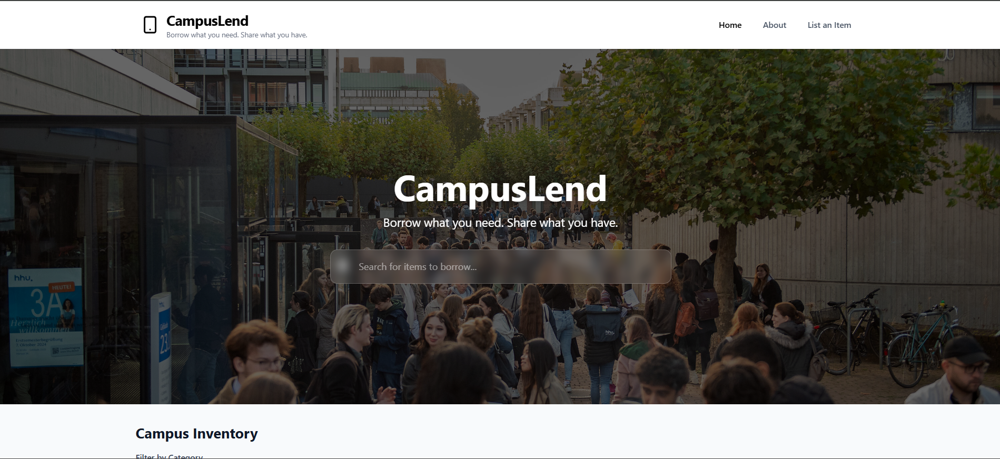

# CampusLend Frontend

A modern, responsive frontend for CampusLend - a peer-to-peer lending platform connecting students and alumni for educational financing.


## Live Demo
[View Live Demo](#) - Link to deployed application

## UI Screenshots
| Home Page | Item Listing | Item Details |
|-----------|--------------|--------------|
|  |  |  |

## Features

- **Responsive Design**: Built with Tailwind CSS for seamless mobile and desktop experiences
- **Client-Side Routing**: React Router DOM for smooth navigation without page reloads
- **Debounced Search**: Efficient search functionality with custom debounce hook to minimize API calls
- **Global Error Boundaries**: Graceful error handling with React Error Boundaries
- **Modern Tech Stack**: React 19, TypeScript, Vite, and Tailwind CSS
- **Accessible Components**: Built with accessibility in mind using semantic HTML and ARIA attributes
- **Optimized Performance**: Service workers, lazy loading, and efficient rendering

## Getting Started

### Prerequisites
- Node.js (v18 or higher)
- npm or yarn

### Installation
1. Clone the repository
   ```bash
   git clone https://github.com/your-username/campuslend-frontend.git
   ```
2. Navigate to the project directory
   ```bash
   cd campuslend-frontend
   ```
3. Install dependencies
   ```bash
   npm install
   ```
4. Start the development server
   ```bash
   npm run dev
   ```
5. Open your browser to `http://localhost:5173`

### Build for Production
```bash
npm run build
```
Preview the production build:
```bash
npm run preview
```

### Run Tests
```bash
npm test
```

## System Architecture

### React Router Implementation
The application uses React Router DOM v7 for client-side routing, enabling a seamless single-page experience. Routes are defined in `src/App.tsx` with a hierarchical structure:
- Public routes: Home, About, Item Details
- Protected routes: Add Item, User Dashboard (to be implemented)
- Navigation is handled through the `Header` component with active link styling
- Route transitions are smooth with React's built-in suspense capabilities

### Debounced Search Hooks
A custom `useDebounce` hook (`src/hooks/useDebounce.ts`) optimizes search functionality by:
- Delaying search API calls until user stops typing for 300ms
- Reducing unnecessary network requests and improving performance
- Preserving search state across component re-renders
- Used in the `SearchBar` component (`src/components/SearchBar.tsx`) to filter items by title, description, and category

### Global Error Boundaries
The application implements React Error Boundaries through `src/components/ErrorBoundary.tsx`:
- Catches JavaScript errors anywhere in the component tree
- Displays a fallback UI instead of crashing the entire application
- Logs error information for debugging purposes
- Wrapped around the main application in `src/main.tsx` to catch routing and rendering errors
- Provides user-friendly error messages with retry options

### Additional Architectural Decisions
- **State Management**: Local component state with React hooks (useState, useEffect) for simplicity
- **Data Fetching**: Custom hooks in `src/api/` for RESTful API communication
- **Styling**: Utility-first approach with Tailwind CSS for rapid UI development
- **Component Architecture**: Reusable, composable components following atomic design principles
- **Type Safety**: End-to-end TypeScript support with strict type checking
- **Performance Optimization**: Code splitting via dynamic imports, image optimization, and efficient re-renders

## Project Structure
```
src/
├── assets/           # Static assets (images, icons)
├── components/       # Reusable UI components
├── hooks/            # Custom React hooks
├── layout/           # Layout components
├── pages/            # Page-level components
├── api/              # API service functions
├── constants/        # Application constants
├── types/            # TypeScript type definitions
└── test/             # Test utilities and setup
```

## Contributing
Contributions are welcome! Please feel free to submit a Pull Request.

1. Fork the repository
2. Create your feature branch (`git checkout -b feature/AmazingFeature`)
3. Commit your changes (`git commit -m 'Add some AmazingFeature'`)
4. Push to the branch (`git push origin feature/AmazingFeature`)
5. Open a Pull Request

## License
This project is licensed under the MIT License - see the [LICENSE](LICENSE) file for details.

## Acknowledgments
- React team for the amazing library
- Vite team for the blazing fast build tool
- Tailwind CSS for the utility-first CSS framework
- All open-source contributors who make projects like this possible